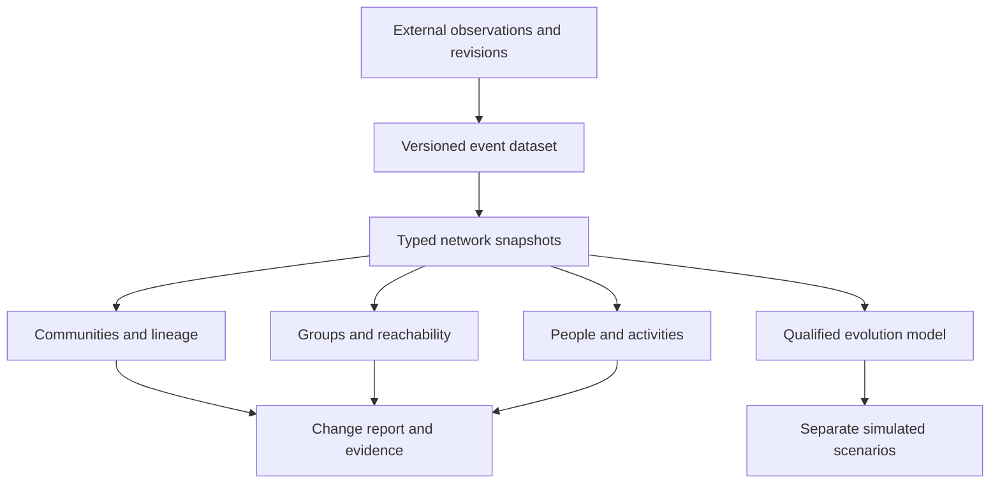

# Dynamic people, activities, language, and network change

Status: **implementation proposal**, 2026-11-27. This document and its small
synthetic upstream experiment do not add the proposed production APIs.
The existing runtime/numerical work is in [PR #4](https://github.com/qigao/SocioLab/pull/4)
at `8ff6be462aa1f4d4e07c0c9963b979d394ff386d`; the design branch starts from
`master@b54dad8b3f8db45ab5d4f6ce987adaacdd898ee8` and changes documentation
and experiment files only.

## 1. Intended capability and decisions

SocioLab should explain how recorded actions and membership changes alter
specific relation networks, and how those changes affect communities,
structural connectors, access, and participation. A later, separately
validated model may estimate future actions or joint network/behavior change.

The immediate deliverable is a reproducible **event-to-network-to-change-report**
pipeline for user data. It should answer:

- Which people, activities, relations, or observed behaviors changed?
- Which network layer changed, under which explicit projection rule?
- Did a bridge disappear, access shrink, a community split, or the useful
  structural connector group change?
- Which original records support that result, and what remains unobserved?
- Is a claimed consequence an observation, a derived graph property, or a
  conditional model scenario?

Decisions for the initial implementation:

1. Keep a versioned, read-only import of external observations; external
   applications remain authoritative for people, communication, and actions.
2. Represent people and activity occurrences separately. Preserve roles,
   time, direction, topics, and observation coverage.
3. Maintain distinct relation layers. Co-participation, communication,
   cooperation, declared trust, and conflict are not interchangeable edges.
4. Generalize the three existing reference adapters using original NetworkX
   algorithms; retain the reference studies as genuine regression cases.
5. Begin with full recomputation of affected snapshots and metrics. Introduce
   incremental optimization only after equivalence with replay is verified.
6. Keep descriptions, model simulations, predictions, and causal estimates
   as different output kinds with separate acceptance requirements.

No second authoritative Agent world, private-memory import, raw TELL-body
store, replacement graph/SAOM algorithm, R/Lean runtime, or new CI/consumer
project is introduced.

## 2. Architecture and ownership



The event dataset is an analytical input, not a new business system of
record. Correcting an import or generating a scenario cannot mutate the
source application's people, messages, memberships, or relationships.
Events exported by an external simulation use `origin=simulation_export`
and retain its run ID. Model-generated actions stay in that simulation's
namespace and never become empirical observations by being reimported.

Modules are thin adapters around upstream algorithms plus data validation,
record selection, aggregation, provenance, and report construction. They do
not implement another community optimizer, centrality engine, diffusion
process, or SAOM solver.

## 3. Data model

### Entities

| Entity | Identity and state |
| --- | --- |
| Person | Stable source-scoped ID; separately observed attributes and membership intervals |
| Activity occurrence | Stable occurrence ID, start/end time, type, location/channel reference, status |
| Participation | Person, activity occurrence, role, attendance status, observed interval, evidence |
| Interaction | Actor, explicit target or recipient, action kind, time, topic/context, evidence |
| Relation observation | Relation layer, endpoints, direction, observed value, time/valid interval, evidence |
| Content annotation | Exact content revision, coder/model version, taxonomy, target, label, evidence span reference |
| Observation coverage | Which population/layer/time interval was observed and whether absence is interpretable |

An activity occurrence is not the same thing as an event-log record. A
meeting can generate invitations, attendance records, utterances, direct
messages, commitments, and later corrections. Recurring sessions get
different occurrence IDs so a series identifier does not collapse multiple
meetings into one shared neighbor.

Historical person IDs remain stable after departure. Presence is represented
by intervals within a specified population, rather than deleting history or
reusing an ID. Entering the population, leaving it, missing an interview, and
the collector going offline are different observations.

### Proposed contract: `sociolab.events.v1`

Use a strict JSON envelope with dataset ID, origin, export revision, entity
catalog, typed records, clock domain, identity mapping, relation/role
codebooks, and source metadata. A dataset uses UTC time or a named simulation
run's ticks; cross-source clock conversion is explicit. The initial implementation uses
files and Python objects; a database, queue, or online service is not required.
Do not add undeclared fields to the existing `network.v1` or `longitudinal.v1`
contracts to approximate these semantics.

Each record includes:

| Field | Meaning |
| --- | --- |
| `record_id` | Unique immutable revision record |
| `fact_id` | Stable identity of the source assertion/action across corrections |
| `operation` | `assert` or `retract` |
| `supersedes` | Previous record ID for a correction/retraction, otherwise null |
| `kind` | Registered typed record kind |
| `occurred_at` | Source event time in the declared clock domain, with precision |
| `recorded_at` / `ingest_seq` | Immutable importer-assigned receipt time and sequence |
| `valid_interval` | Optional source-declared interval for duration/state assertions |
| `source` | Source system/record, revision, content fingerprint, evidence reference |
| `payload` | Strict fields determined by `kind` |

Initial kinds: `membership.observed`, `actor.attribute.observed`,
`activity.observed`, `participation.observed`, `interaction.observed`,
`relation.observed`, `coverage.observed`, and `annotation.recorded`.
Add `membership.changed` and `relation.changed` only for a source that
explicitly owns a state-change log. An interaction's registered payload
distinguishes utterance, confirmed delivery, cooperation, and conflict actions;
each has its own required roles, targets, and evidence fields.
The suffix describes what the source claims; it does not independently
authenticate an arbitrary supplied source. An annotation remains a measured
or inferred label, including when a human created it.

Identity and time rules:

- Reimporting identical bytes for the same record is idempotent. Reusing its
  ID with different bytes is an error. Conflicting revision branches fail;
  file order cannot silently resolve them.
  Local receipt metadata is excluded from the source-content deduplication
  hash. `supersedes` must reference an existing predecessor of the same
  source and fact; cross-fact pointers, cycles, and forks fail.
- Separate event IDs with identical text remain separate occurrences.
  Cross-source reports are separate evidence unless an explicit event-identity
  mapping establishes that they describe one occurrence. A true later
  relationship ending is a new event, not a retraction of its earlier existence.
- For an as-known query, first freeze an exact importer sequence/batch prefix
  `K`, then resolve correction/retraction chains available in that prefix.
  Receipt metadata cannot be backdated by the source. Entity catalogs and
  identity mappings also have availability revisions; an identity merge learned
  later cannot change an earlier as-known graph.
- After resolving revisions, select by record semantics: instant events fall
  in `[start,end)`; durations intersect that window and contribute only their
  overlap; state views replay the pre-window change history to establish the
  initial state before applying in-window changes. A person who joined at
  time 0 remains eligible in `[10,20)` when the source state says so.
  Missing initial state remains unknown. Later corrections cannot leak into
  earlier prediction or historical views.
- Future-effective assertions do not apply before their valid time. Point
  observations do not persist forever; carry-forward requires an explicitly
  declared source-state log or analytical assumption in the view specification.
- An uncertain occurrence-time range is not an actual duration. Preserve the
  distinction and reject time-specific queries that the source cannot support.
- Equal timestamps use source ordering where available. A deterministic
  serialization order is not evidence of causal order; indistinguishable
  simultaneous records must not create a fabricated temporal path.
- Membership absence, dyad absence, and unknown observation are separate.
  Initial comparisons that require complete coverage reject incomplete
  inputs; they never zero-fill them into existing SAOM panels.
  Complete message collection does not establish complete friendship/trust
  observations. Do not silently intersect rosters to manufacture a stable cohort.
- Entity mappings, selected source revisions, correction policy, view rules,
  and algorithms all contribute to reproducibility hashes.

### Language and conflict records

For an utterance, preserve the speaker, activity/context, intended target,
topic, time, source-content reference, and separately known delivery or
receipt. Mentioning a person, addressing them, and their actually receiving
the message must remain separate fields or records.

For example, the invented statement “I oppose proposal P” has a proposal
target. It does not by itself establish hostility toward the proposal's
author. An annotation can label disagreement about P; an observed threat,
direct insult, cancelled collaboration, or explicit trust rating is a
different kind of evidence and belongs to the appropriate layer.

An annotation identifies method, model/coder version, taxonomy, exact target
record ID, content hash, target, and evidence span reference with a span unit.
An uncalibrated classifier
score is not a probability. Raw sensitive content stays in the source
system; SocioLab accepts permitted references and structured annotations.
An annotation remains attached to its exact historical content revision.
It must not be applied to a newer revision until recomputed or explicitly
reconfirmed; earlier as-known views retain the original annotation.
Current views require an effective, unretracted, revision-matching target
at the same knowledge cutoff. A withdrawn or replaced target makes the
annotation stale for that view, even when the text itself did not change.

Language processing may propose labels; it cannot silently write friendship,
trust, or hostility facts. If a later simulation renders dialogue, the text
expresses an explicitly sampled model action in a simulated namespace and
does not become a newly observed real-world event.

## 4. Typed snapshots and projection rules

Propose `sociolab.snapshot.v1` with stable person identities and an explicit
eligible-node policy, one relation
layer, direction, time window, knowledge cutoff, coverage, edge semantics,
weights, provenance links, and a view-specification hash.

| Layer | Edge meaning | Initial materialization |
| --- | --- | --- |
| Participation | Person participates in an activity occurrence | Original person–activity bipartite edges; role/status filters explicit |
| Co-participation | Two people share selected activities | Upstream projection of that bipartite graph; always marked derived |
| Communication | Recorded directed interaction | Count eligible interactions in the window; no inferred receipt |
| Cooperation | Observed cooperation relation or actions | Source-declared relation state, or separately labeled action-count view |
| Trust | Explicit trust observation | Preserve observation scale/direction; no sentiment substitution |
| Disagreement/conflict | Recorded or coded action toward an explicit target | Separate topic/direction/type view with positive conflict counts |

Do not subtract conflict from cooperation into an unexplained “net social
weight.” People can cooperate and disagree simultaneously. Standard community
analysis on a conflict-count layer finds concentrations of conflict links,
not necessarily allied factions. A genuinely signed-network model needs its
own upstream algorithm and empirical interpretation.

Each view specifies relation, role filters, topic filters, eligible population,
time window, cutoff, handling of durations, weight aggregation, and coverage
requirements. Initial weights are explicit counts or supplied positive
strengths; no automatic trust decay, emotion decay, or guessed reaction rule.
Changing a rule produces a new view identity rather than a misleading
time-change comparison under the old identity.

State snapshots use `eligible_at(t)`; window event/participation counts use
`eligible_any_overlap([start,end))` and include only each person's eligible
events/intervals. Someone who speaks at time 12 and leaves at 15 remains in
the `[10,20)` communication view. Their exposure duration is partial, not a
full window. The roster policy and exposure units are part of the view hash.

Activity co-affiliation does not prove simultaneous presence. Use actual
session occurrences when co-presence is intended; interval overlap requires
an explicitly qualified view. A large activity remains one activity node
with its incidence edges, even when users do not request a dense projection.

## 5. Generalize the three analyses

### 5.1 Community analysis and temporal lineage

Initial default: upstream
[`nx.community.louvain_communities`](https://networkx.org/documentation/stable/reference/algorithms/generated/networkx.algorithms.community.louvain.louvain_communities.html)
on a selected simple Graph/DiGraph with positive `strength`. Record seed,
resolution, node/edge order, relation, direction, version, and window.
Retain greedy modularity for the existing Karate reference. No implicit
symmetrization, negative-edge absolute values, or desired-community-count
constraint is permitted.

Keep isolated people in the node set. Empty/no-edge inputs get an explicit
applicability status; undefined modularity is not a zero-quality measurement.
Use identical settings for cross-window comparisons. Algorithm randomness,
changed resolution, and observation changes must not be presented as social
movement. Repeat-seed sensitivity is an explicit optional analysis, not an
automatic search for the most appealing partition.

Partitions have no inherent persistent names. For each adjacent window:

1. Determine common **observable** people; report entrants/leavers separately.
2. Preserve every old/new community overlap, its count, Jaccard, retention,
   and contribution fractions. Report potential continuation, split, merge,
   appearance, and disappearance under declared overlap rules.
3. For display-ID continuity only, build an old/new community bipartite graph
   using qualifying overlaps and call upstream
   [`nx.max_weight_matching`](https://networkx.org/documentation/stable/reference/algorithms/generated/networkx.algorithms.matching.max_weight_matching.html)
   with integer overlap counts and `maxcardinality=False`.
4. Retain the complete many-to-many lineage even when only one child inherits
   an old display ID. Record ambiguous equal-score matches; their names have
   no substantive meaning. No common observable people means no comparable
   membership-stability score.

A stable partition can coexist with a critical bridge loss. Modularity
changes alone also cannot prove stronger real-world cohesion. Track components,
cross-community edges, reachability, and membership alongside the partition.

NetworkX 3.7 also contains executable Leiden, including directed support;
it is an optional later algorithm choice. Its default CPM objective differs
from modularity. Do not confuse algorithm changes with objective changes.
No scikit-learn dependency is needed for initial overlap/lineage reporting.

### 5.2 Key groups and structural effects

Every result declares its objective. Initial selection generalizes the
existing **unweighted group betweenness** use of
[`nx.prominent_group`](https://networkx.org/documentation/stable/reference/algorithms/generated/networkx.algorithms.centrality.prominent_group.html)
with explicit greedy mode, and re-scores the returned group using
[`nx.group_betweenness_centrality`](https://networkx.org/documentation/stable/reference/algorithms/generated/networkx.algorithms.centrality.group_betweenness_centrality.html).
Do not choose the top k individual scores and call that group optimization.

Initial selection admission: connected simple undirected graph,
`1 <= k <= min(4,n-2)`, enough eligible candidates, and a declared computation
budget. Upstream's `C` is an exclusion set. Use the re-scored value because
the search return is rounded. Disconnected selection is outside our first
scope, not universally prohibited by NetworkX.

The review reproduced `KeyError: 0` for NetworkX 3.7
`prominent_group(nx.path_graph(4, create_using=nx.DiGraph), 1)` and an outward
directed star. Do not broaden generic directed selection on the strength of
the Karate regression. Directed candidate-group scoring is a separate,
testable capability; unsupported selection must fail explicitly without
silently converting the graph.

Later objectives can expose upstream group in/out-degree coverage and
distance measures with their own interpretation. Shortest-path weights mean
distance/cost; community weights mean strength. A frequency must not silently
serve both roles. Weighted group selection is outside the first slice.

When a network changes, report the old group's score on the old and new
networks, whether its members remain eligible, and a new selected group's
score when selection is supported. Show denominator/population changes.
If any member is absent from the new snapshot, the original group's new
score is unavailable with a reason. Scoring its surviving members produces
a different group and must be labeled accordingly.
This measures structural position, not leadership, intent, mediation ability,
optimal diffusion seeds, or an intervention's social effect.

### 5.3 People–activity analysis

Preserve the original undirected bipartite graph with disjoint person and
activity IDs and validate its partitions. Filter roles and attendance status
before deriving a requested co-participation view.

- [`weighted_projected_graph`](https://networkx.org/documentation/stable/reference/algorithms/generated/networkx.algorithms.bipartite.projection.weighted_projected_graph.html)
  gives shared-activity counts; `ratio=True` divides by the number of activity
  nodes, not by activity size.
- [`collaboration_weighted_projected_graph`](https://networkx.org/documentation/stable/reference/algorithms/generated/networkx.algorithms.bipartite.projection.collaboration_weighted_projected_graph.html)
  gives Newman weights: each shared activity contributes `1/(participants-1)`.
  This reduces a large activity's per-pair weight without removing its clique.

Both outputs remain **derived affiliation**. Neither establishes friendship,
trust, actual conversation, or conflict. Standard projections do not consume
incidence-edge duration/intensity weights; extending those semantics requires
an explicit formula and separately qualified upstream callback path.

Directed `person -> activity -> person` projection represents a directed
two-step path. A graph containing only `person -> activity` links does not
produce the desired co-participation pairs. Preserve speaker/listener roles
in records, and do not fabricate receipt by projecting a public speaker to
everyone listed in an audience.

Require activity-size/attendance coverage for size-normalized comparisons.
Retain activity IDs supporting each derived pair, along with raw incidence
counts, projected pair counts, and the selected formula. Avoid automatic
materialization of quadratic-size projections for very large events; either
analyze the bipartite input or require an explicit bounded projection request.

## 6. What a change report says

Propose `DESCRIPTIVE_NETWORK_CHANGE` containing:

| Section | Output |
| --- | --- |
| Inputs | Before/after dataset and snapshot hashes, window/cutoff, identical view policy and algorithm settings |
| Source changes | New, corrected, and retracted records; supporting evidence IDs |
| Population | Joined, left, still present, and unobserved people, separately |
| Relations | Added/removed/reweighted edges per layer, with derivation references |
| Structure | Components, isolates, reachability, bridges or directed connectivity, denominators |
| Communities | Memberships, complete lineage, display IDs, cross-community links, ambiguity |
| Key groups | Objective, eligibility, original-group and new-group scores, supported scope |
| Activities | Participation changes, roles, activity size, derived pair changes |
| Outcomes | Actually observed commitments, cooperation, withdrawal, or other defined outcomes when supplied |
| Interpretation | Observed / derived / model-simulated labels; applicability and coverage limits |

These reports can support statements such as “the recorded collaboration
bridge disappeared,” “cross-group communication decreased in this window,”
or “more coded disagreements were directed at this proposal.” They cannot
turn those into “this sentence caused a split” or a person's stable character.

Optional leave-one-record-out recomputation describes a record's computational
contribution to a view. It is a structural sensitivity calculation, not proof
of the counterfactual outcome if that real action had never happened.
Configured alerts use explicit baselines/windows and separate changes in
data collection from changes in behavior; no universal conflict-risk score
is introduced.

### Executed synthetic examples

The [saved report](experiments/2026-11-27-dynamic/bridge-and-event.json) and
[reproduction script](experiments/2026-11-27-dynamic/run_examples.py) call
the actual NetworkX 3.7 functions. They are small design examples, not
empirical results or a completed dynamic adapter.

| Quantity | Two triangles with bridge C–D | Same graph after explicit bridge removal |
| --- | ---: | ---: |
| People | 6 | 6 |
| Edges | 7 | 6 |
| Connected components | 1 | 2 |
| Other people reachable from each node | 5 | 2 |
| Greedy communities | ABC / DEF | ABC / DEF |
| Modularity | 0.3571428571 | 0.5 |
| C and D individual betweenness | 0.6 each | 0 each |
| Fixed group C,D betweenness | 2/3 | 0 |

Before removal, upstream greedy group selection picks C and D with group
betweenness `2/3`; scoring that same supplied group after removal gives zero.
Selection after disconnection was intentionally not run
under the proposed initial admission rule. Removing one bridge changes
access while leaving the community membership unchanged.

A second example has six people attending one activity: six observed
incidences produce **15 derived person pairs**. Each count weight is 1;
each Newman weight is 0.2, and the Newman projection still has 15 pairs.
No direct interpersonal relationship was observed in that example.

## 7. Behavior, language, and prediction

Descriptive event analysis and statistical evolution models have different
time requirements. Preserve fine-grained event order even when presenting
window snapshots. A static path A–B–C does not establish an information path
if B–C occurred before A–B. Temporal networks require explicit time-respecting
path semantics; ordinary snapshot reachability must be labeled structural
potential rather than actual transmission [S7].

For utterances, replies, assistance, and disputes at event times, relational
event models are a relevant future model family [S8]. No qualified Python
relational-event estimator is selected by this design, so this is an upstream
selection task rather than permission to write a local replacement.

For observed network/behavior panels, the next executable model candidate is
the existing cusna 0.1.0 **one binary network plus one ordinal behavior** path:

```python
# Proposed adapter wiring, not an implemented SocioLab API or accepted fit.
data = SaomData(waves, behavior=behavior_values)
if data.symmetric:
    raise ValueError("directed coevolution profile cannot infer a symmetric model")
model = MomEstimator(
    data,
    effects=[EffectSpec("density"), EffectSpec("recip"),
             EffectSpec("transTrip"), EffectSpec("simX", dyn=True)],
    beh_effects=[BehEffectSpec("linear"), BehEffectSpec("quad"),
                 BehEffectSpec("avAlt")],
    conditional=False, backend="cpu", seed=seed,
)
```

The behavior and effects must be selected for a declared research question;
this example is not a universal model specification. `simX` represents
behavior-dependent selection, while the behavior-side terms permit modeled
network influence. Their interpretation requires qualified measurements,
longitudinal data, diagnostics, and model assessment [S6].

Source inspection establishes this candidate API, **not numerical admission**:

- The initial profile is directed and preserves the existing symmetric-data
  rejection. Reciprocal observations do not authorize paired undirected tie
  changes; the pinned data API has no documented force-directed override.
- `SaomData(..., behavior=Z)` requires one `(n,n_waves)` behavior matrix.
  The behavior-side effect names are `linear`, `quad`, `avAlt`, `avSim`,
  and `totSim`. This path is unconditional, unlike the current adapter.
  Validate the ordinal domain and nondegenerate range before passing it to
  upstream; do not round arbitrary sentiment scores or embeddings into it.
  Alter-based behavior terms use ego's outgoing neighbors, so the relation
  direction must match the intended exposure/selection meaning.
- Current SocioLab diagnostics are fixed to three evaluation parameters and
  conditional duration fields. Coevolution includes network/behavior rates
  and additional effects, so it needs a model descriptor, explicit parameter
  layout, and diagnostics sized for the actual free-parameter count.
- Pinned cusna rejects composition change together with dependent behavior.
  Its supported composition mechanism is restricted to integer wave times;
  this cannot be advertised as arbitrary event-time joins/leaves.
- The separate multi-network estimator has cross-network effects, but rejects
  dependent-behavior effects. It does not establish a single fitted model of
  friendship + conflict + multiple behaviors + text.
- Neither path provides native `-1/0/+1` signed ties or a demonstrated
  language-to-action model. Keep these combinations explicitly unsupported.

The current conditional estimator uses the observed end-period tie distance
as its stopping target. It must not use a held-out future endpoint to claim
forecast accuracy. A future forecast requires a past-only fit, frozen
preprocessing (including behavior centering/range), a qualified unconditional
forward simulator, explicit future exposure/rate/covariate assumptions,
multiple simulations, and genuine time-held-out evaluation. Convergence on
training data is not forecast accuracy.

Model outputs should be distributions over defined outcomes: edge changes,
reachability, fragmentation, or measured behavior. A single simulated future
is not a prediction guarantee. Fitted scenario comparisons are also separate
from causal intervention effects, which require additional identification.

## 8. Proposed interfaces and implementation sequence

Proposed modules and entry points (not current CLI commands):

```text
events.py       load_event_dataset(path), validate_event_dataset(...)
snapshots.py    materialize_snapshot(dataset, view_spec, knowledge_cutoff)
communities.py community_report(snapshot, settings), compare_communities(...)
keyplayers.py  select_key_group(snapshot, objective, constraints)
               score_key_group(snapshot, members, objective)
affiliations.py affiliation_report(snapshot, projection_spec)
changes.py     compare_snapshots(before, after, analysis_spec)
```

CLI proposals: `events validate`, `snapshot`, `communities analyze`,
`communities compare`, `keyplayers select`, `keyplayers score`,
`affiliations analyze`, and `changes`. Reference commands can call the same
generic implementations with explicitly constructed reference snapshots;
do not keep a separate authoritative algorithm for each example.

| Stage | Concrete implementation | Exit criterion |
| --- | --- | --- |
| D1 | Strict event dataset, revisions/coverage, membership and typed snapshot materialization | Replay is deterministic; corrections, time cutoffs, unknown observations and stable IDs are correct |
| D2 | Generic community, group scoring/selection and affiliation APIs; original reference adapters reuse them | Actual pinned upstream results agree within the declared graph/objective scope |
| D3 | Cross-window changes, community lineage, population-aware comparisons and evidence references | Splits/merges/bridge loss and source corrections are distinguished from label churn or collection gaps |
| D4 | Language/behavior observation adapters and explicit conflict views | Target/role/time taxonomy validated on labeled data; no automatic promotion to trust or friendship |
| D5 | Separate one-network/one-behavior upstream coevolution adapter | Real CPU fit, parameter-layout diagnostics, matching independent reference and qualified data; then held-out modeling work |

D1–D3 provide useful dynamic analysis without language generation or a new
statistical model. D4 can ingest manually labeled or source-supplied records
before any NLP model is introduced. D5 depends on Issue #2's numerical
acceptance and Issue #3's empirical qualification; it does not close either
issue by merely exposing constructor arguments.

### Acceptance cases in the existing native suite

1. Exact replay and identical-record reimport produce identical snapshots;
   conflicting identities/versions fail.
2. A later correction or retraction changes the appropriate current view
   while preserving the earlier as-known view, including historical identity
   mappings and annotations bound to their effective target revisions.
3. Join, leave, rejoin, failed collection, and observed zero relations are
   represented distinctly; unknowns never become silent zeros.
4. Changing only an actor attribute or an unaccepted language annotation
   does not change topology.
5. Activity cancellation/corrected attendance invalidates the appropriate
   projection once, without double counting or inventing direct relations.
6. The six-person activity generates 15 derived pairs; size adjustment changes
   weights rather than claiming those pairs were directly observed.
7. Repeated identical graph/settings produce the same partition; merely
   renaming labels does not report membership change.
8. Splits/merges preserve all lineage links; changing population is reported
   separately from switching communities among common observed people.
9. A bridge removal reduces access even when communities remain unchanged.
10. Directed group selection, too-large groups, negative strengths and
    incompatible weight semantics fail at their declared scope boundary.
11. Greedy selected groups are re-scored by real upstream functions; candidate
    scoring and selection have distinct contracts.
12. Window expiry can change a view even without a new event. Cache keys and
    invalidation include window/cutoff, source revisions and policy versions.
    Pre-window state and overlapping durations survive the correct window
    query; mid-window departures do not erase earlier eligible actions.
13. Partial order cannot fabricate time-respecting transmission; snapshot
    reachability remains explicitly structural until temporal algorithms qualify.
14. Future model acceptance excludes future endpoints, future annotations,
    held-out normalization statistics, and post-outcome community labels.

No new installer/consumer test project or workflow is needed. Test only the
new contracts and real upstream behavior; avoid duplicating optimizers in
expected-value helpers. Performance qualification uses explicit actor/event/
edge counts, group size, window width, and actual timings. There is no large-
network or realtime performance claim from the six-person design experiment.

## 9. Recompute strategy and later presentation

Initially, ingest a versioned batch, select its as-known records, materialize
each requested layer/window, run upstream algorithms, and write an immutable
report with its inputs. Reuse a result only when its full input/settings hash
matches. A local edge change can affect shortest paths and community choices
globally; updating only adjacent nodes is not initially a correctness claim.

Use bounded batching for repeated source updates. Time-window expiry and
corrections are invalidations even without a new social action. Later caching
or incremental algorithms must reproduce full replay under the same inputs.

A future UI should expose a time selector, layer selector, event/evidence
timeline, community lineage, group objective, and before/after differences.
Keep visual positions stable where possible; a layout reshuffle is not a
network change. Simulated scenarios get a separate view with uncertainty,
model version and assumptions. The initial delivery remains CLI/API + JSON.

## Sources and version basis

- **S1:** NetworkX 3.7, commit `49ca2290b80c1389eb4d8d8e49dcba73f8fec016`:
  [community source](https://github.com/networkx/networkx/blob/49ca2290b80c1389eb4d8d8e49dcba73f8fec016/networkx/algorithms/community/louvain.py),
  [group centrality](https://github.com/networkx/networkx/blob/49ca2290b80c1389eb4d8d8e49dcba73f8fec016/networkx/algorithms/centrality/group.py),
  [bipartite projection](https://github.com/networkx/networkx/blob/49ca2290b80c1389eb4d8d8e49dcba73f8fec016/networkx/algorithms/bipartite/projection.py),
  [matching](https://github.com/networkx/networkx/blob/49ca2290b80c1389eb4d8d8e49dcba73f8fec016/networkx/algorithms/matching.py).
- **S2:** [NetworkX Leiden 3.7 source](https://github.com/networkx/networkx/blob/49ca2290b80c1389eb4d8d8e49dcba73f8fec016/networkx/algorithms/community/leiden.py).
- **S3:** cusna 0.1.0, commit `313c3d2623c99ed15c1eb6fe713593c6d3915d1d`:
  [data and composition](https://github.com/artemmaltsev74-techcom/cusna/blob/313c3d2623c99ed15c1eb6fe713593c6d3915d1d/prototype/cusna/saom/data.py),
  [estimation](https://github.com/artemmaltsev74-techcom/cusna/blob/313c3d2623c99ed15c1eb6fe713593c6d3915d1d/prototype/cusna/saom/mom.py),
  [effects](https://github.com/artemmaltsev74-techcom/cusna/blob/313c3d2623c99ed15c1eb6fe713593c6d3915d1d/prototype/cusna/saom/stats.py).
- **S4:** [Current SocioLab adapters and input contracts](https://github.com/qigao/SocioLab/tree/8ff6be462aa1f4d4e07c0c9963b979d394ff386d/src/sociolab).
- **S5:** [Current runtime and numerical review PR](https://github.com/qigao/SocioLab/pull/4).
- **S6:** Snijders, [Networks and Behavior](https://www.stats.ox.ac.uk/~snijders/siena/Net_longi7_C_p.pdf), 8 March 2023.
- **S7:** Holme and Saramaki, [Temporal Networks](https://arxiv.org/abs/1108.1780), Physics Reports 519 (2012), 97–125.
- **S8:** Butts, [A Relational Event Framework for Social Action](https://doi.org/10.1111/j.1467-9531.2008.00203.x), Sociological Methodology 38 (2008), 155–200.
