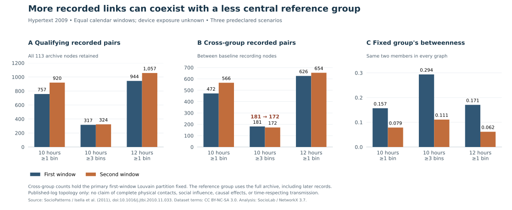

# A real recorded-contact case: more links, a less central reference group

**Execution date: 2026-11-28 (Asia/Tokyo). Scope: retrospective description of the published Hypertext 2009 contact log.**

Two equal ten-hour windows contain **757 and 920 recorded contact pairs**, while
the normalized group betweenness of the same two-person reference group falls
from **0.156812 to 0.078703**. The direction of that score change survives the
two declared sensitivity checks. A different result is sensitive: cross-group
pairs between nodes already recording contacts in the first window increase
**472 → 566** under the one-bin rule, but decrease **181 → 172** when a pair
must have at least three recorded bins in its window.

These results establish what the supplied records and declared graph rules
produce. They do not identify a change in friendship, social influence,
attendance, information transmission, or a causal mechanism. This case has no
language, conflict, or behavior measurements with which to explain the changes.



*Figure: calculations from the SocioPatterns Hypertext 2009 contact list, using
original NetworkX 3.7 algorithms. All panels retain the same 113 archive IDs.
The middle panel uses the primary first-window partition throughout; the right
panel uses the same retrospectively selected group throughout. Source:
[SocioPatterns](https://sociopatterns.org/datasets/hypertext-2009-dynamic-contact-network/),
[Isella et al. (2011)](https://doi.org/10.1016/j.jtbi.2010.11.033).
The dataset page links [CC BY-NC-SA 3.0](https://creativecommons.org/licenses/by-nc-sa/3.0/).
The source archive and participant-level records are not redistributed here.*

## Research question and source choice

The question is: **how do recorded cross-community connections, static
reachability, and one fixed reference group's structural position differ
between two equal calendar windows?** This is a bounded real-data application
of SocioLab's existing community and group-analysis adapters.

The official dataset describes badge proximity in 20-second bins, with each
timestamp `t` representing `[t−20,t]`. Its declared origin is UNIX
`1246255200`, corresponding to 2009-06-29 06:00 UTC and the source's documented
08:00 local time. The paper reports approximately 75% voluntary participation;
the public files do not establish device uptime or complete exposure for each
node. See the [official source definition](https://sociopatterns.org/datasets/hypertext-2009-dynamic-contact-network/)
and the [author-deposited paper, Sections II–III](https://iris.unito.it/bitstream/2318/1731001/2/1006.1260.pdf).

The reviewed TSV contains **20,818 pair-bin records, 113 distinct endpoint
identifiers, and 2,196 distinct unordered pairs**. These are direct counts of
the retrieved artifact, not a census of conference participants. The graph
includes all 113 IDs in every window, including IDs whose only records occur
later in the archive. This fixed universe makes denominators consistent, but
uses hindsight and does not establish an attendance roster.

| Source check | Result |
| --- | --- |
| Compressed TSV | 67,463 bytes |
| Compressed SHA-256 | `43014e65bb8f6aa7d75d36a8ab61279b617bee88197e04a330c4386305ae1738` |
| Decompressed SHA-256 | `ed7fcc05f614cd47ffa230183ce2375af140fd13ca98a253d236f9ba043f695e` |
| Repeated unordered pair-bin records / self-pairs | 0 / 0 |
| Reverse pair orientations canonicalized | 7,267; no rows discarded |
| First / last recorded bin endpoint | 20 / 212,360 seconds after origin |
| Complete physical-contact observation | Not established |

The CLI admits only the exact reviewed decompressed payload for this case.
Equivalent recompression is permitted and fingerprinted separately. Parsing
all supplied rows is distinct from establishing that all physical contacts
were observed. An absent graph edge means only that the supplied file has no
pair satisfying that scenario's window and threshold.

The alternate official interval JSON was checked separately. It has 111 outer
keys but 113 IDs after including neighbor keys, and one interval starts at 21
seconds rather than the 20-second grid. Expanding candidate interval labels
as `range(start,end,20)` produces 90 records absent from the TSV and omits 90
TSV records. Flooring that start would make this diagnostic agree, but **no
such repair is applied**. The case uses the unmodified TSV. The two formats
are encodings of related source data, not independent sensor measurements.
The exact diagnostic is in [source-review.json](experiments/2026-11-28-recorded-contact/source-review.json).

## Fixed analysis protocol

The [protocol](experiments/2026-11-28-recorded-contact/protocol.json) was fixed
after source-format counts were known and before case structural results were
computed. It was **not publicly preregistered**. Later output additions report
singleton communities and the reference group's recorded degrees; they do not
change the windows, thresholds, selection, seeds, or previous numeric results.

| Scenario | First window, UTC | Second window, UTC | Pair rule |
| --- | --- | --- | --- |
| Primary: 10 hours | June 29, 06:00–16:00 | June 30, 06:00–16:00 | At least one recorded bin |
| Threshold sensitivity: 10 hours | June 29, 06:00–16:00 | June 30, 06:00–16:00 | At least three cumulative recorded bins |
| Window sensitivity: 12 hours | June 29, 06:00–18:00 | June 30, 06:00–18:00 | At least one recorded bin |

All dates are in 2009. For aligned bin-start windows `[start,end)`, a record is
included exactly when **`start < t <= end`**. Three bins need not be consecutive
and do not establish a continuous minute of conversation. Calendar windows
have equal lengths; per-person attendance and device exposure are unknown.

Each graph is simple, undirected, and unit-weighted. Bin totals are reported
separately, without converting contact counts into shortest-path distances.
Louvain uses `seed=0`, `resolution=1`, and `weight=None`. It runs independently
for each window for community comparisons. A fixed seed makes this execution
reproducible; uniqueness and robustness across seeds or algorithms remain
unassessed.

For cross-group counts, the **primary first-window partition is held fixed
across all six graphs**, including the sensitivity cases. This makes the
reference explicit. It also fits the partition to the first window: an
increase in later cross-partition edges is not a test of social integration.
First-window zero-record nodes form singleton reference groups, so their later
records are counted separately from pairs between first-window recording nodes.

The two-person reference group is selected once on the **full archive graph**
with original `networkx.prominent_group(greedy=True)`. Its exact members are
then rescored, without replacement, in every window using original
`networkx.group_betweenness_centrality`, with normalized, unweighted,
non-endpoint settings. Selection uses records after both primary windows,
including the third day. It is a retrospective reference, with no baseline
optimality, global optimality, forecast, or intervention claim. Only the group
identity hash is exported.

## Primary result: topology changes while the node universe stays fixed

| Quantity | First 10-hour window | Second 10-hour window |
| --- | ---: | ---: |
| Fixed archive node universe | 113 | 113 |
| Nodes with at least one recorded pair | 97 | 102 |
| Nodes with no recorded pair | 16 | 11 |
| Recorded pair-bins | 5,448 | 5,777 |
| Distinct recorded pairs | 757 | 920 |
| Largest connected component | 97 | 102 |
| Components, including singletons | 17 | 12 |
| Structurally reachable unordered pairs | 4,656 | 5,151 |
| Reachable fraction of all 6,328 possible pairs | 73.58% | 81.40% |
| Mean other nodes structurally reachable | 82.41 | 91.17 |
| Graph bridges | 5 | 2 |
| Same reference group's normalized betweenness | 0.156812 | 0.078703 |
| Reference members with qualifying records | 2 of 2 | 2 of 2 |
| Sum of reference members' degrees | 111 | 72 |

There are **222 retained pairs, 698 pairs recorded only in the second window,
and 535 recorded only in the first**. Thus the net increase of 163 pairs hides
substantial recorded-pair turnover. Those labels describe record-set changes,
not confirmed relationship formation or dissolution.

The recorded graph becomes more connected under these rules, while the fixed
reference group has a lower share of shortest-path intermediation. Both group
members still have records, so a wholly zero-record member does not account
for the score drop. Their combined degree also falls, and other edges change.
The comparison does not decompose these contributions or identify why people
changed their behavior. It gives no direct evidence of a change in social
power or actual information flow.

Reachability is computed on each static aggregated graph. A path can combine
contacts in an order that is impossible in time. No time-respecting
transmission or observed diffusion is asserted. Keeping all 113 IDs fixes the
reachability denominator and the group-score normalization; it does not adjust
for different observation opportunities.

### Cross-group change depends on which nodes and records are counted

| Relative to the fixed primary first-window partition | First window | Second window | Difference |
| --- | ---: | ---: | ---: |
| All cross-group recorded pairs | 472 | 748 | +276 |
| Cross-group pairs between first-window recording nodes | 472 | 566 | +94 |
| Cross-group pairs touching a first-window zero-record node | 0 | 182 | +182 |
| Within-group recorded pairs | 285 | 172 | −113 |

Fourteen of the 16 first-window zero-record nodes appear on qualifying
cross-group pairs in the second window. Their 182 pairs are about two-thirds
of the total cross-group increase. They are records becoming visible for
those nodes under this window definition; they do not prove participant entry,
new friendships, or prior absence of contact.

### Fewer reported communities does not establish social merging

| Louvain output | First window | Second window |
| --- | ---: | ---: |
| Total communities | 22 | 18 |
| Singleton communities | 16 | 11 |
| Communities with more than one node | 6 | 7 |
| Modularity | 0.186864 | 0.179433 |

The total count falls because the singleton count falls, while the number of
multi-node communities rises. Interpreting `22 → 18` as four social groups
merging would be unsupported. The JSON also retains the aggregate community
overlap matrix and matching statistics. Its split/merge labels classify
overlapping algorithmic partitions; they are not observed social fission,
merger, or individual allegiance changes.

## Sensitivity: which conclusions survive the declared choices?

| Scenario | Qualifying pairs | Cross-group pairs between primary first-window recording nodes | Static reachable-pair fraction | Same group's betweenness |
| --- | --- | --- | --- | --- |
| 10 hours, ≥1 bin | 757 → 920 | 472 → 566 | 73.58% → 81.40% | 0.156812 → 0.078703 |
| 10 hours, ≥3 cumulative bins | 317 → 324 | **181 → 172** | 64.71% → 75.11% | 0.293747 → 0.110954 |
| 12 hours, ≥1 bin | 944 → 1,057 | 626 → 654 | 78.22% → 81.40% | 0.170574 → 0.061720 |

Under the three-bin threshold the net pair increase is only **7**, compared
with **163** under the primary rule. The direction of the cross-group change
among primary first-window recording nodes reverses. That particular increase
is therefore sensitive to including pairs with only one or two bins.

In contrast, static reachability increases and the same reference group's
score decreases in all three declared scenarios. The two group members have
qualifying records in all six graphs. This is limited descriptive consistency
across the chosen processing settings. It is not a confidence interval, a
missing-sensor model, evidence that every reasonable specification agrees, or
proof of a stable social mechanism.

Three-bin graphs have **22 and 15 zero-qualifying-degree nodes**, although
only **16 and 11 nodes have no raw records** in those windows. The distinction
matters: records below the threshold are retained in the source audit and
counted as excluded from that graph, not erased or relabeled as unobserved
physical contact.

## What this contributes to SocioLab

The case makes the relationship between observations and structural change
concrete. The actor list stays fixed, while changed recorded-pair sets produce
different components, partitions and group scores. It also demonstrates three
important interpretation checks with real data: separating singleton counts,
separating first-window zero-record nodes in cross-group comparisons, and
checking whether a processing choice changes a finding's direction.

The implementation adds one reviewed-source loader and a narrow study command;
it reuses the existing community and key-group adapters and original NetworkX
algorithms. It does not bypass the completeness requirements of the general
snapshot API. The result is explicitly `RECORDED_CONTACT_CASE_STUDY`, with
physical observation completeness, population qualification, prediction and
causal identification left unestablished. No SAOM fit runs here.

For the broader behavior/language/conflict question, the next empirical step
requires such measurements and their observation coverage, plus explicit rules
linking them to the relevant relation layer. This contact archive cannot answer
whether a conflict caused a split or speech changed trust. It supplies an
executed descriptive comparison on which a properly measured study can build.

## Mauldin boundary check: progress without silently filling missing ties

A parallel [candidate-cohort audit](experiments/2026-11-28-recorded-contact/mauldin-candidate-audit.json)
narrows the Mauldin source question. Using cohorts 1–3, original study
enrollment and the documented wave-4 departure code reconstructs candidate
counts **74 → 72 → 70**, with **63 wave-4 survey responses**, consistent with
the totals described in [Mauldin et al. (2022), Sections 2.2 and 2.5](https://www.mdpi.com/2227-7102/12/3/205).
This is not independent verification of the identities in the paper's exact
analytic roster. Excluding later departures also makes this a retrospective
survivor cohort, not a past-only baseline population.

Within that candidate set, the archived wave-4 friendship file has **56 egos
with positive nominations, four explicit blank responses, and ten `NA`
responses**. The paper reports nine missing friendship responses and five
students reporting no friends. The discrepancy remains unresolved; no `NA`
is converted to a blank response to make the counts agree. Eight candidate
egos with unknown outgoing friendship responses still receive 43 known
within-candidate incoming nominations, which remain observed.

The source also contains friendship nominations from candidate egos to other
cohorts. The paper's restricted analysis roster cannot by itself settle the
eligible nomination range for every archived file. The candidate audit retains
`NOT_ESTIMABLE`, creates no complete graph or longitudinal panel, and fits no
model. Further detail is in the [updated source-admission guide](mauldin-source-admission.md#candidate-cohort-checkpoint-2026-11-28).

## Reproduce and inspect the evidence

Obtain the TSV gzip from the [official dataset page](https://sociopatterns.org/datasets/hypertext-2009-dynamic-contact-network/)
and keep it outside the repository. From the repository root:

```bash
python -m pip install -e .
python -m sociolab study hypertext2009 /path/to/ht2009_contact_list.dat.gz
python docs/experiments/2026-11-28-recorded-contact/run_case.py /path/to/ht2009_contact_list.dat.gz --output /path/to/case-output
python docs/experiments/2026-11-28-recorded-contact/independent_case_check.py --raw-gzip /path/to/ht2009_contact_list.dat.gz --case-report /path/to/case-output/case-report.json --output /path/to/case-output/case-verification.json
python -m unittest discover -s tests -v
```

The CLI emits aggregate JSON. Exit 0 means this descriptive computation
completed; it does not qualify an empirical causal or predictive model.
Malformed files and unreviewed source payloads exit 2. The figure renderer
uses Matplotlib as a documentation-only dependency; it is not required by the
study command:

```bash
python docs/experiments/2026-11-28-recorded-contact/render_figure.py
```

| Evidence | Purpose |
| --- | --- |
| [protocol.json](experiments/2026-11-28-recorded-contact/protocol.json) | Fixed source, windows, thresholds, community and reference-group decisions |
| [source-review.json](experiments/2026-11-28-recorded-contact/source-review.json) | Official-source provenance, file hashes and TSV/JSON discrepancy |
| [case-report.json](experiments/2026-11-28-recorded-contact/case-report.json) | Full aggregate results, overlap matrices and interpretation flags |
| [case-execution.json](experiments/2026-11-28-recorded-contact/case-execution.json) | Actual CLI exit, runtime, source-code hashes and output hashes |
| [case-verification.json](experiments/2026-11-28-recorded-contact/case-verification.json) | Independent raw-TSV / original-NetworkX comparison |
| [validation.json](experiments/2026-11-28-recorded-contact/validation.json) | Final regression and artifact verification |
| [native-tests.log](experiments/2026-11-28-recorded-contact/native-tests.log) | Full native regression output |

The final native suite passes **259 tests**, with no skips. A separate parser
and direct calls to original NetworkX independently reproduce **622 selected
aggregate values and sequence lengths**, with zero mismatches. That check uses
BFS reachability counts as a separate calculation of the reachable-pair totals.
It shares the NetworkX dependency and does not independently validate the
community-matching algorithm, sensor coverage, or scientific interpretation.
Existing SAOM implementations and dependency declarations are unchanged; no
additional SAOM fit or CPU qualification is claimed by this case.

These artifacts export aggregate statistics and hashes. They contain no source
row list, original participant IDs, selected-member list, or individual
attributes. Source-specific audits and computational agreement do not resolve
the prior partial-SAOM reference discrepancy documented in
[the separate partial-network work](partial-networks.md).
