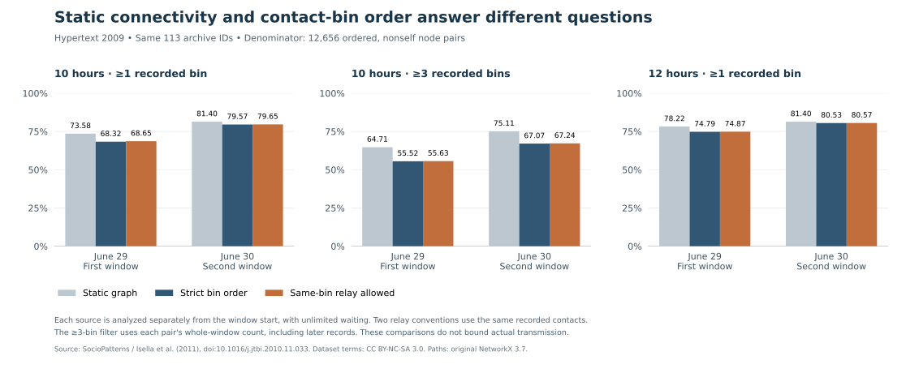
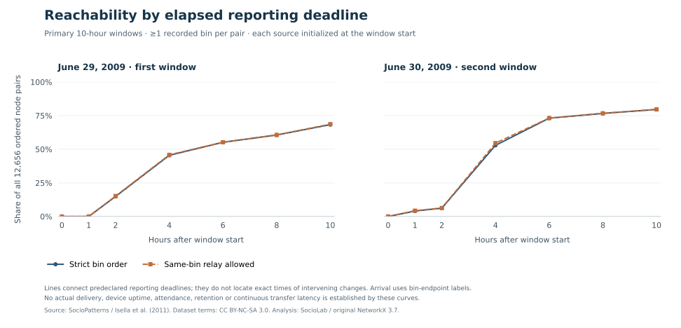

# Recorded contacts: static connectivity and time-respecting reachability

**Execution date: 2026-11-28 (Asia/Tokyo). Scope: retrospective paths through published contact-bin records under explicit relay conventions.**

This case extends the [executed static Hypertext study](recorded-contact-case.md)
with contact order. It asks how many source–target pairs remain reachable when
a path must follow recorded bins chronologically, and how much the answer
depends on allowing more than one contact hop within a 20-second bin.

**Main result:** in the primary first window, the static graph has **9,312**
reachable ordered node pairs, while strict bin order permits **8,647** and
same-bin relay permits **8,688**. In the second window the corresponding
counts are **10,302 / 10,071 / 10,080**. The second window ends with more
reachable pairs, but at the two-hour reporting deadline its strict count is
**784**, versus **1,885** in the first window. End-of-window connectivity does
not describe the whole time profile.

## Executed results

All results below come from the [actual CLI report](experiments/2026-11-28-temporal-contact/temporal-report.json),
with **763 independent aggregate comparisons and full internal pair/arrival
hash checks agreeing**, and **276 native tests passing**. The original static
CLI output is byte-identical to the preceding case's retained output. Full
validation details and reproduction instructions follow below.



### Static paths can depend on unusable contact order

| Primary 10-hour windows | June 29 | June 30 |
| --- | ---: | ---: |
| Static reachable ordered pairs | 9,312 (73.58%) | 10,302 (81.40%) |
| Strict bin-order reachable pairs | 8,647 (68.32%) | 10,071 (79.57%) |
| Same-bin relay reachable pairs | 8,688 (68.65%) | 10,080 (79.65%) |
| Static pairs without a strict bin-order path | 665 | 231 |
| Unordered pairs reachable in only one direction, strict rule | 659 | 231 |

Percentages use the fixed 12,656 ordered-pair denominator. Of the first
window's statically reachable pairs, **7.14%** have no strict bin-order path;
the corresponding share is **2.24%** in the second window. These are gaps
between graph conventions, not observed failed message deliveries. The
one-direction counts show that undirected contacts can still produce
asymmetric temporal reachability.

The final reachable counts remain higher in the second window in both
predeclared sensitivity cases:

| Scenario | Static, first → second | Strict, first → second | Same-bin relay, first → second |
| --- | --- | --- | --- |
| 10 hours, ≥1 bin | 9,312 → 10,302 | 8,647 → 10,071 | 8,688 → 10,080 |
| 10 hours, ≥3 cumulative bins | 8,190 → 9,506 | 7,026 → 8,489 | 7,040 → 8,510 |
| 12 hours, ≥1 bin | 9,900 → 10,302 | 9,466 → 10,192 | 9,476 → 10,197 |

This is consistency across these declared settings, with the same observation
and retrospective-filter limitations. It does not establish a general social
mechanism or an effect of individual behavior.

### Greater final reachability does not imply more reachability at every deadline



| Elapsed reporting deadline | June 29 strict reachable pairs | June 30 strict reachable pairs |
| --- | ---: | ---: |
| 1 hour | 4 (0.03%) | 513 (4.05%) |
| 2 hours | **1,885 (14.89%)** | **784 (6.19%)** |
| 4 hours | 5,757 (45.49%) | 6,698 (52.92%) |
| 6 hours | 6,984 (55.18%) | 9,250 (73.09%) |
| 8 hours | 7,668 (60.59%) | 9,699 (76.64%) |
| 10 hours | 8,647 (68.32%) | 10,071 (79.57%) |

At the two-hour deadline the first window has more reachable pairs; at the
four-hour deadline the second has more. The ordering is therefore not uniform
over the reported deadlines. These measurements describe hypothetical
availability from each window's start. They do not identify actual delivery
speed, event schedules, activity causes or continuous-time crossing points
between the sampled deadlines.

### Same-bin assumptions affect arrival labels beyond the final count

Allowing same-bin relay adds **41** reachable ordered pairs in the first main
window and **9** in the second. Among pairs already reachable under strict
order, it advances the earliest bin endpoint for **641** and **1,872** pairs,
respectively. Every common pair is checked to arrive no later under the more
permissive convention. A small final-count difference therefore coexists with
many different earliest-arrival labels.

Conditional means need care as well. In the first window the mean offset
over reachable pairs is **14,194.1 seconds** under strict order and
**14,221.5 seconds** with same-bin relay. The latter includes 41 additional
reachable pairs, while every common pair's endpoint is unchanged or earlier.
The higher conditional mean reflects the changed set being averaged and does
not establish a deterioration for shared pairs. These offsets are bin labels
including initial waiting, not measured continuous transmission latencies.

## What the comparison measures

The [official SocioPatterns source](https://sociopatterns.org/datasets/hypertext-2009-dynamic-contact-network/)
labels each contact with an endpoint `t` for the interval `[t−20,t]`. The file
does not supply precise ordering inside that interval. Its source definition,
fingerprints, volunteer coverage limits and TSV/JSON encoding discrepancy
remain documented in the [original source audit](experiments/2026-11-28-recorded-contact/source-review.json).
This analysis uses the same unmodified, fingerprint-qualified TSV payload.

In the temporal-network literature, a time-respecting path follows
nondecreasing contact times; a strict path requires increasing times. See
[Kempe, Kleinberg and Kumar, Section 1](https://david-kempe.com/publications/time.pdf)
and [Zschoche et al., MFCS 2018](https://doi.org/10.4230/LIPIcs.MFCS.2018.45).
Applying those ideas to the source's binned timestamps requires an explicit
choice about contacts sharing one bin:

| Convention | Allowed contact sequence | Meaning of two contacts A–B and B–C in the same bin |
| --- | --- | --- |
| Static comparator | Time labels are ignored | A and C are connected |
| Strict bin order | Endpoints strictly increase; at most one contact hop per bin | That two-hop route is unavailable in that bin |
| Same-bin relay allowed | Endpoints are nondecreasing; multiple hops may share a bin | That two-hop route is available under this convention |

Each source is analyzed **separately**, with a hypothetical signal available
at that source when its window starts. Nodes may retain it and wait until the
window ends, including through gaps with no records. A recorded contact is
treated as a usable bidirectional channel under the selected convention.
These rules do not establish actual information retention, successful
transfers, device uptime, participant presence, bandwidth or propagation
probabilities. The question is existence of each individual path, not a
capacity-constrained simultaneous broadcast.

The three reachable-pair sets satisfy, and the implementation checks:

\[
R_{\text{strict}} \subseteq R_{\text{same-bin}} \subseteq R_{\text{static}}.
\]

This is a model inclusion relationship on **the same selected records**.
It is not a confidence interval or a physical upper/lower bound for real
transmission. Unrecorded contacts and unmeasured transfer delays lie outside
all three graphs.

### Time changes the direction of reachability

Suppose the only records are `A–B@20` and `B–C@40`. A can reach C in recorded
time order. C cannot follow the same contacts back to A, because its first
opportunity to reach B comes after the A–B contact. Swapping the two contact
times reverses that direction while leaving the static graph unchanged.

| Three-node synthetic example | Static ordered reachable pairs | Strict ordered reachable pairs | Same-bin ordered reachable pairs |
| --- | ---: | ---: | ---: |
| A–B at 20; B–C at 40 | 6 | 5 | 5 |
| A–B and B–C both at 20 | 6 | 4 | 6 |

The tests execute these examples with original NetworkX. Temporal reachability
between actors is also generally nontransitive: knowing that A can eventually
reach B and B can reach C from the window start does not guarantee A arrives
at B before B's opportunity to reach C. The actor reachability relation is not
passed to ordinary connected-component or community algorithms as a purported
temporal community.

## Fixed population, windows and counting rules

All **113 archive endpoint IDs** remain in every window, including nodes with
no qualifying record. This is the same retrospective archive universe used
by the static case; it is not an independently verified attendance roster.

Temporal reachability counts **ordered, distinct-actor pairs**. Its denominator
is therefore `113 × 112 = 12,656`. The original static report counted unordered
pairs. For comparison here, its reachable-pair count is doubled; its fraction
is unchanged. A target actor is counted once per source, even if many of that
actor's time states are reachable, and source-to-self paths are excluded.

| Scenario | First window, UTC in 2009 | Second window, UTC in 2009 | Pair inclusion |
| --- | --- | --- | --- |
| Primary, 10 hours | June 29, 06:00–16:00 | June 30, 06:00–16:00 | At least one bin |
| Threshold sensitivity, 10 hours | June 29, 06:00–16:00 | June 30, 06:00–16:00 | At least three cumulative bins |
| Window sensitivity, 12 hours | June 29, 06:00–18:00 | June 30, 06:00–18:00 | At least one bin |

The endpoint rule is `start < t <= end`. Equal calendar length does not imply
equal device exposure or attendance.

The three-bin case preserves the earlier static study's **whole-window
qualification**: count a pair's bins over the entire window, then retain all
of its in-window bins if it qualifies. Its early records therefore depend on
later records for eligibility. This is explicitly flagged as
`pair_filter_uses_later_window_records=true`; it is not an online rule that
activates a pair only after its third record. Three bins need not be
consecutive and do not establish a continuous minute of conversation.

The [protocol](experiments/2026-11-28-temporal-contact/protocol.json) was fixed
before computing the temporal results. The preceding static case's results
were already known. The protocol was **not publicly preregistered**. It fixes
the two relay conventions, three scenarios, source initialization, waiting,
denominators, reporting deadlines and computation budgets.

## Arrival summaries use bin endpoints

For each reachable ordered pair, the calculation finds the earliest reachable
recorded-bin endpoint and subtracts the window start. This includes waiting
before the first usable contact. For example, contacts at endpoints 20 and
200 can give an A→C arrival label of 200 seconds after the start. Two contact
hops do not imply a 40-second delay.

Minimum, median, mean and maximum arrival offsets are conditional on that
mode's reachable pairs. Unreachable pairs are not replaced with zero or the
window length. An empty reachable set has unavailable (`null`) arrival
statistics. Because the reachable sets can change between windows, comparing
their conditional means alone does not establish that the same pairs became
faster.

Cumulative counts are also reported at elapsed hours **1, 2, 4, 6, 8 and 10**,
with hour **12** added for the longer windows. These fractions use all 12,656
ordered pairs, including unreachable pairs. The labels describe recorded-bin
endpoints under the assumptions above, not measured continuous delivery times.

## Implementation through original NetworkX

The source-specific entry point reuses the existing bounded gzip/TSV loader,
the exact decompressed payload fingerprint and the original three scenario
definitions. It does not rerun community detection or group selection. The
existing `study hypertext2009` command keeps its static result unchanged.

The new narrow Python API is:

```python
from sociolab.temporal_contacts import temporal_contact_report

report = temporal_contact_report(
    (1, 2, 3),
    ((20, 1, 2), (40, 2, 3)),
    start=0,
    end=40,
    deadlines_seconds=(20, 40),
)
```

It transforms records into a sparse directed graph with before/after states
for each actor/bin incidence and start/end states for every actor. Waiting
edges connect an actor's successive states. Each record supplies two
before-to-after contact edges, one in each direction. The strict graph
permits one contact hop in a bin. Adding same-bin after-to-before edges allows
the nonstrict convention, including cycles within a bin.

The original
[`networkx.single_source_shortest_path_length`](https://networkx.org/documentation/stable/reference/algorithms/generated/networkx.algorithms.shortest_paths.unweighted.single_source_shortest_path_length.html)
performs all source searches. Its returned keys identify reachable states;
its graph-edge distances are never interpreted as elapsed time. Earliest
arrival is aggregated from reached states' timestamps. No local path-search
solver, propagation update engine, or new dependency is introduced.

With `N` actors, `I` distinct actor/bin incidences and `R` retained pair-bin
records, both phase graphs contain `2N + 2I` states. The strict graph has
`N + 2I + 2R` edges; the nonstrict graph has `N + 3I + 2R`. These exact sizes
are checked before allocation, against limits of 200 actors, 50,000 total
input records, 200,000 expanded states and 400,000 edges. Over-budget input
fails instead of dropping actors, sampling records or substituting an engine.

The public reports contain aggregate counts, component sizes for the static
comparator, reporting-deadline summaries and hashes of the internal pair and
arrival results. They do not export original actor IDs, per-actor results,
pair lists, raw records or expanded states. Arrival hashes encode absolute
endpoints; displayed arrival summaries use offsets from the window start.

## Reproduce the case and validation

Keep the official source gzip outside the repository, then run:

```bash
python -m pip install -e .
python -m sociolab study hypertext2009-temporal /path/to/ht2009_contact_list.dat.gz
python docs/experiments/2026-11-28-temporal-contact/run_temporal_case.py /path/to/ht2009_contact_list.dat.gz --output /path/to/temporal-output
python docs/experiments/2026-11-28-temporal-contact/independent_temporal_check.py --raw-gzip /path/to/ht2009_contact_list.dat.gz --case-report /path/to/temporal-output/temporal-report.json --output /path/to/temporal-output/temporal-verification.json
python -m unittest discover -s tests -v
```

Exit 0 means the descriptive computation completed. Unreviewed payloads,
invalid records and unsupported budgets fail. No download or source repair is
performed by the command. Existing source-coverage and complete-snapshot
requirements are unchanged.

The independent checker parses the original TSV without importing SocioLab.
It uses a different sparse actor/time representation: strict contact edges
connect `(source,t−20)` to `(target,t)`, while nonstrict contact edges connect
same-time states. Consecutive same-actor times supply waiting edges. Original
`networkx.descendants` computes its reachability. It compares full internal
pair/arrival hashes and aggregate results, while exporting no row-level data.
This checks graph encoding and integration with a shared NetworkX dependency;
it does not establish a second independently implemented graph solver or
validate physical transmission.

The actual temporal CLI completed with exit 0 and empty stderr in **12.768
seconds** in the recorded environment; this execution time is not a performance
benchmark. Its report has three scenarios and six windows. The largest
production graph has **24,002 states and 49,909 edges**. Independent verification
matches **763 aggregate fields and sequence lengths**, including the reachable
pair and absolute-arrival hashes for all twelve temporal graphs. The **276
native tests** pass without skips, including 17 new source/temporal tests.
The existing static CLI was rerun once to check the new dispatch and exactly
matches its retained report SHA-256
`523a058a26036cf499b8ff166d68171a19f178aac3204ca6d93dc0bb9d2583b9`.

| Evidence | Purpose |
| --- | --- |
| [protocol.json](experiments/2026-11-28-temporal-contact/protocol.json) | Decisions fixed before temporal results |
| [temporal-report.json](experiments/2026-11-28-temporal-contact/temporal-report.json) | Actual aggregate results and interpretation flags |
| [temporal-execution.json](experiments/2026-11-28-temporal-contact/temporal-execution.json) | Actual CLI exit, runtime and source/input/output hashes |
| [temporal-verification.json](experiments/2026-11-28-temporal-contact/temporal-verification.json) | Different graph encoding and direct upstream path calculation |
| [static-cli-regression.json](experiments/2026-11-28-temporal-contact/static-cli-regression.json) | Byte comparison with the previously recorded static CLI output |
| [validation.json](experiments/2026-11-28-temporal-contact/validation.json) | Final regression and artifact checks |
| [native-tests.log](experiments/2026-11-28-temporal-contact/native-tests.log) | Complete native regression output |

The figure renderer requires Matplotlib only for documentation:

```bash
python docs/experiments/2026-11-28-temporal-contact/render_temporal_figures.py
```

## Interpretation boundary

`recorded_bin_order_paths_computed=true` records this new capability.
`time_respecting_transmission_validated=false`, population qualification,
causal identification and forecast qualification remain unchanged in meaning.
No actual transmission, temporal community, temporal key-group centrality or
SAOM model is inferred. In particular, the earlier static reference group's
score is not applied to duplicated time states or relabeled as temporal
influence. Mauldin admission and the partial-SAOM independent-reference
discrepancy remain separate open questions.

Source attribution: **SocioPatterns collaboration**,
[Hypertext 2009 dataset](https://sociopatterns.org/datasets/hypertext-2009-dynamic-contact-network/);
Isella et al., [*What's in a crowd? Analysis of face-to-face behavioral
networks*](https://doi.org/10.1016/j.jtbi.2010.11.033), *Journal of Theoretical
Biology* 271 (2011), 166–180. The dataset page links
[CC BY-NC-SA 3.0](https://creativecommons.org/licenses/by-nc-sa/3.0/).
No raw source data are redistributed in this repository.
